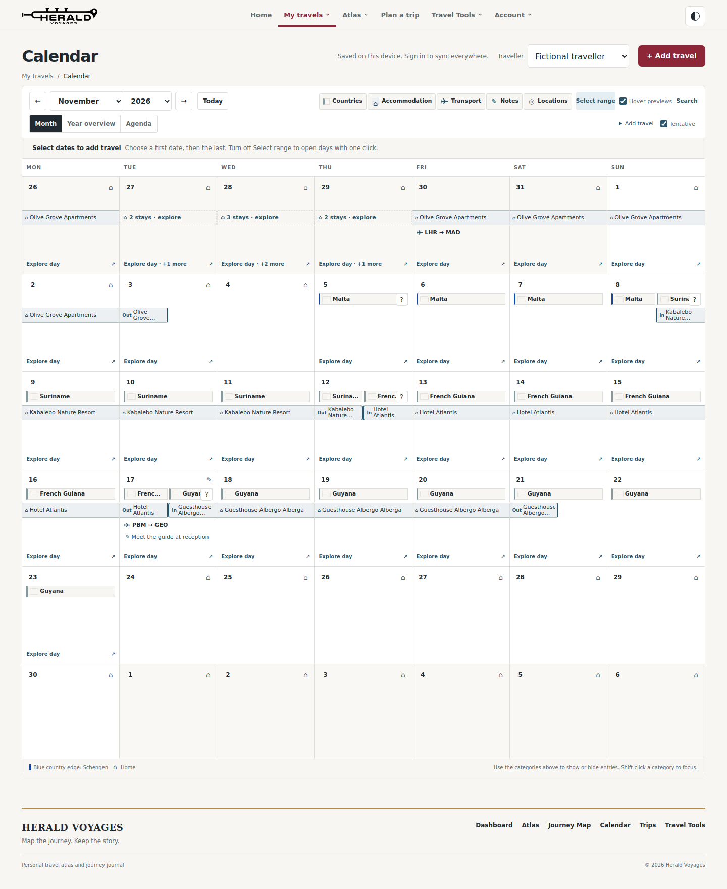

# Calendar design restoration — 24 October 2026

Restore the earlier Month presentation requested in the supplied October/November screenshots while keeping the published V1 functionality. This is a presentation change, not a rollback of the V1 release or saved records.

- Roomier, consistently sized day cells and the earlier country/accommodation/transport hierarchy.
- Equal side-by-side country badges on border days, with full accessible labels and overflow disclosure.
- The thin connected accommodation ribbon with compact inline Out/In cues.
- Explicit “Explore day” links at the bottom of populated cells.
- Month/Year controls below the main toolbar on wide screens; the hover preference is directly visible on desktop. Tablet and phone controls reflow without overlap.
- Agenda, date-range selection, rich details, search, entry reminders and all tentative-plan operations remain available. Small-screen filter selection closes the popup and returns focus so the reset action remains reachable.

Save failure handling, recoverable trip drafts, optional membership, trip itineraries, Home, Places, budget reconciliation, airport display corrections, storage keys and the account/database code are unchanged.

## Verification

The layout and read-only preservation checks passed at 1440, 1280, 1024, 768, 390 and 360 CSS pixels in both themes. Targeted keyboard/focus, persisted views, contrast and reflow checks passed. Calendar selection, chronology, interactions, save/draft recovery, contextual actions, budget/Places/Home and airport checks were exercised with fictional local fixtures and intercepted external requests. The actual previous-version-to-restoration offline upgrade passed, retaining saved records, identities, references, geometry, artwork and pending/deletion sentinels. The pull request records the final CI results.

The dense desktop grid returns to 1189px from the V1 compact 902px, intentionally restoring the roomier design. Full fixture payloads remain equal before/after read-only browsing. The planning test now waits for the existing 80ms drag-release click guard before a separate action; production drag logic and saved plans are unchanged.

These images use fictional travel data. The image-generation reference preview is not used as a site asset; the calendar remains the existing interactive implementation.

[Light screenshot](month-light.png) · [Dark screenshot](month-dark.png)

