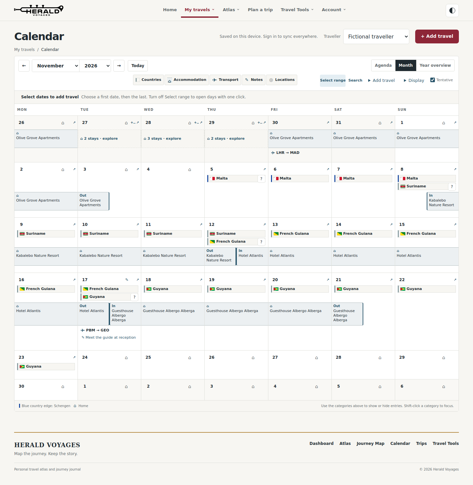
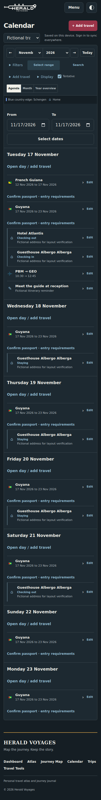

# Candidate evidence — 21 October 2026

All travel in these images and measurements is fictional. Both releases use the same fixture and fixed clock. See [the completion report](../../V1-CANDIDATE.md) for acceptance limits and remaining release gates.

## Calendar comparisons

| Viewport | Light | Dark |
| --- | --- | --- |
| 1440×900 | [Before](before/calendar-1440-light.png) · [After](after/calendar-1440-light.png) | [Before](before/calendar-1440-dark.png) · [After](after/calendar-1440-dark.png) |
| 1280×800 | [Before](before/calendar-1280-light.png) · [After](after/calendar-1280-light.png) | [Before](before/calendar-1280-dark.png) · [After](after/calendar-1280-dark.png) |
| 1024×768 | [Before](before/calendar-1024-light.png) · [After](after/calendar-1024-light.png) | [Before](before/calendar-1024-dark.png) · [After](after/calendar-1024-dark.png) |
| 768×1024 | [Before](before/calendar-768-light.png) · [After](after/calendar-768-light.png) | [Before](before/calendar-768-dark.png) · [After](after/calendar-768-dark.png) |
| 390×844 | [Before](before/calendar-390-light.png) · [After](after/calendar-390-light.png) | [Before](before/calendar-390-dark.png) · [After](after/calendar-390-dark.png) |
| 360×800 | [Before](before/calendar-360-light.png) · [After](after/calendar-360-light.png) | [Before](before/calendar-360-dark.png) · [After](after/calendar-360-dark.png) |

The deliberate accommodation gap after 21 November remains visible. True overlaps remain disclosures rather than an invented sequence. See [baseline heights](before/metrics.json), [candidate heights](after/metrics.json) and [complete-payload preservation hashes, IDs and counts](after/preservation.json).

## Home before/after

| Width | Light | Dark |
| --- | --- | --- |
| 1440 | [Before](before/home-1440-light.png) · [After](after/home-1440-light.png) | [Before](before/home-1440-dark.png) · [After](after/home-1440-dark.png) |
| 1280 | [Before](before/home-1280-light.png) · [After](after/home-1280-light.png) | [Before](before/home-1280-dark.png) · [After](after/home-1280-dark.png) |
| 1024 | [Before](before/home-1024-light.png) · [After](after/home-1024-light.png) | [Before](before/home-1024-dark.png) · [After](after/home-1024-dark.png) |
| 768 | [Before](before/home-768-light.png) · [After](after/home-768-light.png) | [Before](before/home-768-dark.png) · [After](after/home-768-dark.png) |
| 390 | [Before](before/home-390-light.png) · [After](after/home-390-light.png) | [Before](before/home-390-dark.png) · [After](after/home-390-dark.png) |
| 360 | [Before](before/home-360-light.png) · [After](after/home-360-light.png) | [Before](before/home-360-dark.png) · [After](after/home-360-dark.png) |

## Phone Agenda and practical flows

| Flow | Light | Dark |
| --- | --- | --- |
| Agenda | [Image](after/agenda-390-light.png) | [Image](after/agenda-390-dark.png) |
| Home | [Image](after/home-390-light.png) | [Image](after/home-390-dark.png) |
| Trip itinerary | [Image](after/trip-itinerary-390-light.png) | [Image](after/trip-itinerary-390-dark.png) |
| Desktop Home | [Image](after/home-1440-light.png) | [Image](after/home-1440-dark.png) |

## Recorded verification

- [Unit result](unit-summary.json): 287 passes across 39 files.
- [Existing browser runner results](regression-results.json): 27 runners; timing checks recorded separately.
- [Performance medians](performance-medians.json): handler/two-frame/cache measures, with raw repeated runs alongside.
- [Final verification summary](verification.json) records command outcomes, timing outliers, release gates and the implementation commit.
- [Final navigation runs](navigation-final-runs.json) retain route reuse, geometry, offscreen focus and restored-scroll checks.

Pixel equality with the old UI is not an acceptance criterion for this intentional interface change. The legacy `test:visual` runner requires a baseline argument and assumes unchanged geometry/styles; the candidate uses these same-fixture before/after captures, preserved-payload assertions and focused readability/layout tests instead.

